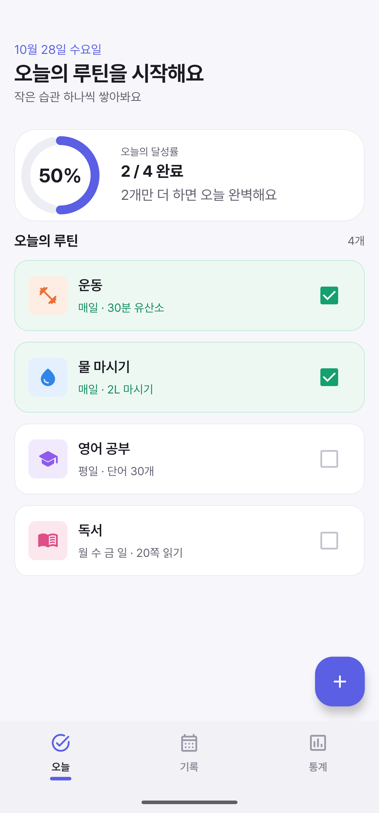
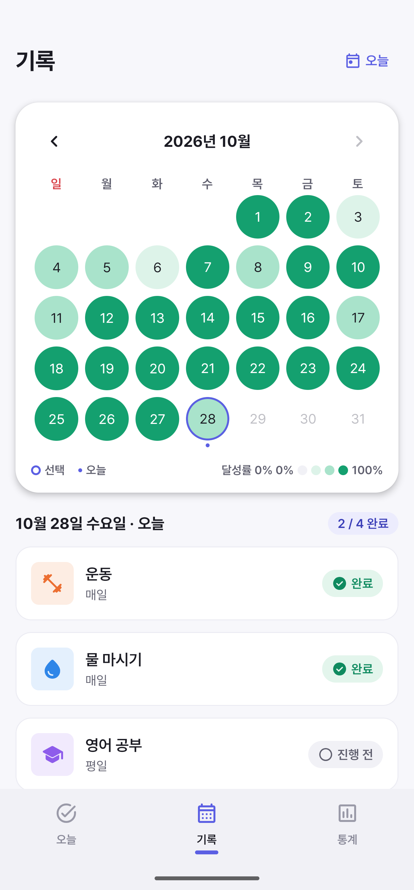
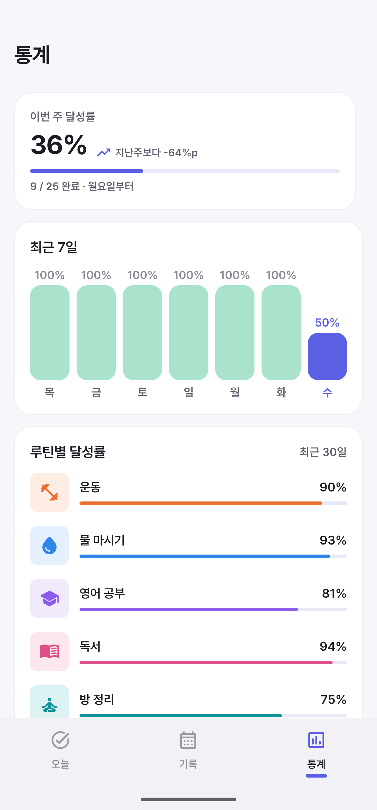
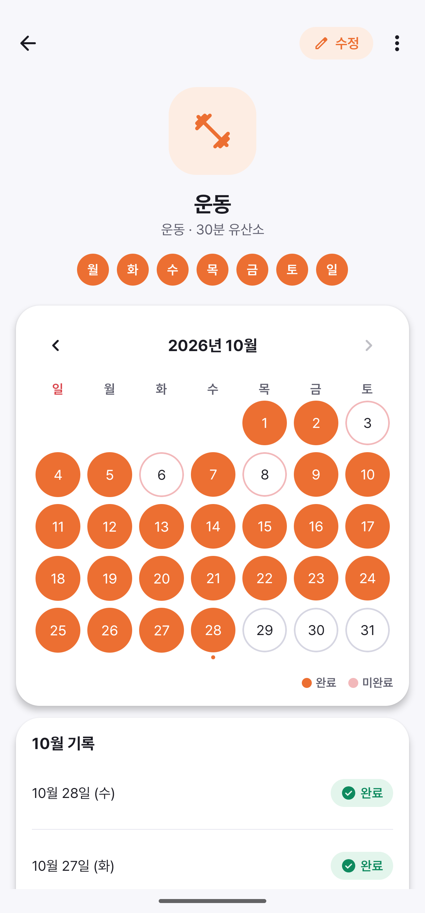

# MyRoutineApp

요일별 반복 루틴을 등록하고, 매일 체크하며, 기록과 통계로 습관을 돌아볼 수 있는 Android 앱입니다.

## 스크린샷

<table>
  <tr>
    <td align="center"></td>
    <td align="center"></td>
    <td align="center"></td>
    <td align="center"></td>
  </tr>
  <tr>
    <td align="center">오늘</td>
    <td align="center">기록</td>
    <td align="center">통계</td>
    <td align="center">루틴 상세</td>
  </tr>
</table>

## 주요 기능

### 오늘
- 오늘 예정된 루틴 목록과 달성률(완료 / 전체) 표시
- 루틴 카드를 눌러 완료 체크/해제
- 루틴 상세 화면으로 이동

### 루틴 추가 · 수정 · 삭제
- 이름, 카테고리(운동·건강·공부·독서·생활), 반복 요일, 목표(선택) 설정
- 카테고리별 색상이 자동 적용되고, 저장 전 미리보기 제공
- 수정 시 요일을 바꾸면 **이후 일정부터 적용**되며 이전 기록은 그대로 유지 (루틴 그룹 분리)
- 상세 화면에서 같은 그룹의 루틴 조회 및 삭제

### 기록
- 월간 캘린더에서 날짜별 달성률을 색 농도로 확인
- 날짜를 선택해 그날의 루틴 완료 여부 확인 및 수정

### 통계
- 이번 주 달성률(월요일 시작)과 지난주 대비 변화
- 최장 연속 달성 일수, 루틴별 연속 달성
- 최근 7일 달성률, 루틴별 최근 30일 달성률

### 알림
- 루틴 알림 채널 및 리마인더 스케줄링
- 기기 재부팅 후 알림 자동 재등록 (`BootReceiver`)
- Android 13+ 알림 권한 요청 및 거부 시 설정 이동 안내

## 기술 스택

| 구분 | 사용 기술 |
|---|---|
| 언어 | Kotlin 2.2 |
| UI | Jetpack Compose, Material 3 |
| 아키텍처 | MVVM (ViewModel + StateFlow) |
| DI | Hilt |
| 로컬 DB | Room (KSP) |
| 네비게이션 | Navigation Compose |
| 빌드 | Gradle Kotlin DSL, Version Catalog |

- minSdk 26 / targetSdk 36 / compileSdk 37

## 프로젝트 구조

```
app/src/main/java/com/jsy/myroutineapp/
├── data/
│   ├── di/            # Hilt 모듈 (Database)
│   ├── local/         # Room DB, DAO, Converter, Preferences
│   └── model/         # Routine, RoutineRecord, RoutineCategory
├── notification/      # 알림 채널, 스케줄러, Receiver
└── ui/
    ├── addRoutine/    # 루틴 추가/수정
    ├── routineDetail/ # 루틴 상세
    ├── today/         # 오늘 탭
    ├── record/        # 기록 탭
    ├── statistic/     # 통계 탭
    ├── navigation/    # NavHost, Routes, BottomTabs
    ├── common/        # 공통 컴포넌트
    └── theme/         # 색상, 타이포그래피, 테마
```

## 데이터 모델

- **Routine**: 제목, 카테고리, 반복 요일, 설명, 시작일, 종료일(nullable), `groupId`
  - 요일을 수정하면 기존 루틴에 종료일을 두고 새 루틴을 같은 `groupId`로 생성하여 과거 기록을 보존합니다.
- **RoutineRecord**: 완료한 날짜만 저장하며 (`routineId`, `date`)는 유일합니다. 루틴 삭제 시 함께 삭제됩니다(CASCADE).

## 빌드 및 실행

1. Android Studio 최신 버전에서 프로젝트를 엽니다. (JDK 11 이상)
2. Gradle Sync 후 에뮬레이터 또는 실기기(API 26+)에서 실행합니다.

```bash
./gradlew assembleDebug
```

## 화면 구성

앱 하단 탭: **오늘** · **기록** · **통계**
그 외 화면: 루틴 추가, 루틴 수정, 루틴 상세
